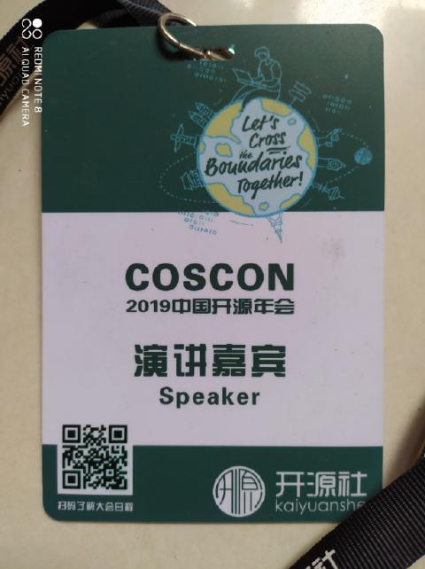

**10 月 13 日**

新开这本纪年史.

**10 月 24 日**

人生若只如初见, 何事秋风悲画扇.

**10 月 28 日**

@secondwtq 提出了一些对演讲稿的修改意见, 返工中.

**10 月 30 日**

新入的主机似乎硬盘有点问题, 和机械师的售后沟通后开始换货流程.

**11 月 01 日**

今天启程去上海.

**11 月 02 日**

中国开源年会第一日, 校园旅游 + 酒吧吹牛.

**11 月 03 日**

中国开源年会第二日, 演讲 "minits: 以 LLVM 为后端的 TypeScript 静态编译器".

**11 月 04 日**

尤克里里到了, 不知有没有书 "21 天精通尤克里里".

**11 月 07 日**

龙体欠安.

**11 月 08 日**

Game Boy 项目破 700 Star!

**11 月 10 日**

周天, 对新书补充了一些内容, 到达 37 万字了.

**11 月 14 日**

老板说又可以涨工资了, 开心.

**11 月 19 日**

撸猫的时候差点被抓伤了, 看来还需要磨练自己的技巧.

**11 月 22 日**

面试大我 5 岁的前辈, 很难受. 逝者如斯夫, 不舍昼夜.

**11 月 23 日**

新书修整了一番, 明日准备将其在 Word 中排版看一看.

**11 月 24 日**

剧院看戏.

**12 月 02 日**

把书稿给出版社看了, 觉得文字多了, 要求把 380 页的内容裁剪成 300 页. 原因是他们后期整理排版和页面的时候, 还会多出很多页纸来, 380 页的纯内容印刷成书定价得过百. 残念.

**12 月 04 日**

三味线真好听.

**12 月 31 日**

2019 年最后一天啦. 既幸运又悲惨的一年, 给今年做下总结:

1. 春, Game Boy 仿真器开源在 github 上, 获得了 700+ star, 上了 github 趋势榜.
2. 夏, 与机械工业出版社签订了合同, 开始写书.
3. 秋, 生病住院好久, 非常可怜.
4. 冬, 参加中国开源年会演讲.

叶子, 明年也要好好加油!
