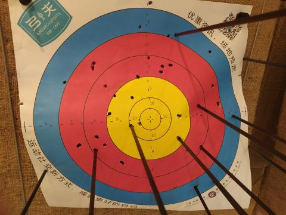
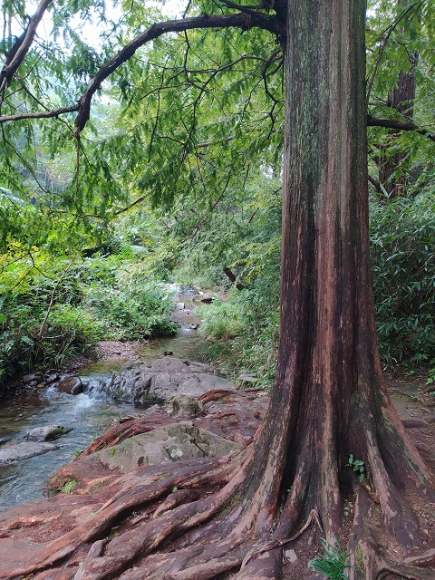

**01 月 08 日**

当需要发表对某个事物看法的时候, 要输出观点, 而不是输出情绪. 慎之!

**01 月 22 日**

武汉新型肺炎真是闹的人心惶惶.

**01 月 24 日**

今日启程回家.

**02 月 01 日**

今日开工. 春节期间几乎没有外出走动, 期间高铁上被查出体温过高, 后来想想是因为前天夜里几乎没睡的关系.

**02 月 10 日**

春节回杭后便被隔离, 今日解禁, 便晒到了久违的阳光, 真暖和!

**02 月 13 日**

我常常收集或记录各种东西, 听到喜欢的歌, 便费劲心思下载过来然后存到某个地方; 看一些技术文章一定要同时做笔记生怕以后会忘记. 以后还是减少这种收集行为吧.

**04 月 07 日**

感谢 v2ex 的 sivacohan 老铁赞助的 100 铃钱!

**04 月 11 日**

新书可能存在版权方面的风险...

**04 月 16 日**

噩耗, 新书已确认不能出版.

**05 月 08 日**

自 4 月 26 日起一直在准备 pywasm 1.0 发布, 今日中午终于跑通全部测试用例, 顺利更新到 pypi 仓库.

**05 月 14 日**

我觉得我进入职业倦怠期了.

**06 月 18 日**

近期在写 WebAssembly 到机器码的 AOT 编译器, 收获还是很大的, 已经能肉眼解析机器码了...

**06 月 27 日**

今日结束端午假期, 一路上风景还不错.

**07 月 11 日**

和朋友一起去玩射箭, 最戏剧性的是在时间到期后我射出的最后一只箭成功中了 10 环!

**07 月 16 日**

夜里大雨, 2 点 50 分时一只白猫从开着的窗户中跳了进来打翻了东西, 被吓醒了, 不过挺可爱的.

**07 月 17 日**

准备本月 26 日 OSDT 的技术分享. 话说我总感觉自己适合写文章, 不适合去演讲.

**07 月 25 日**

晌午后飘雨, 空气清新.

**07 月 26 日**

今日 Meetup 分享, 其它的分享者都是牛人哦. 天气还在飘雨.

**08 月 27 日**

近日小区房东挨家挨户在检查淋浴器, 询问说是有租客淋浴时发生了事故(电死了).

**10 月 06 日**

今天是国庆中秋长假的第 6 日, 这几天一直在玩游戏, 偶尔看看书, 味道还不错.

**10 月 12 日**

游戏真的是电子海洛因, 删掉之后整个人就回复正常了. I'm back!

**10 月 18 日**

与林勤, 万涔涔前去九溪十八涧游玩, 数了, 确认只有八条溪.

**10 月 21 日**

豆豆的公司又倒闭了.

**11 月 06 日**

公司组织了一次冲刺, 一周都在公司.

**11 月 15 日**

晴, 西溪湿地游玩, 所谓的风景, 就是众人所喜爱的地方吧. 意外见到一处人民会堂遗址.

**11 月 18 日**

夜里看《来自深渊: 深沉灵魂的黎明》, 初看以为是部幼齿动画(低估一些漫画家的变态程度了...

**12 月 04 日**

去年的时候不懂事, 把申请到的 Google Adsense 账号放着吃灰结果被回收了, 今年从 1 月份开始申请了无数次, 直到现在还没通过. 能人生重来吗?

**12 月 07 日**

Google Adsense 又申请回来了, 昨天一天的广告收入是 0.16 美元.

**12 月 22 日**

靠挂广告实现睡后收入目前看来不可行额, 收入太低了.

**12 月 30 日**

今日同德医院体检.
