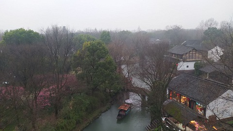
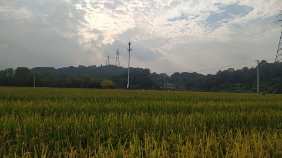

**01 月 26 日**

新年回家, 吃上了久违的灯盏糕.

**02 月 13 日**

**03 月 11 日**

灵隐寺背后的山.

**06 月 05 日**

感谢 v2ex 的 sivacohan 老铁再次赞助的 101 铃钱!

**06 月 13 日**

今日上线微信小游戏: 像素推箱!

**06 月 23 日**

端午节, 前往采摘杨梅.

**07 月 07 日**

钱塘江夜游.

**07 月 19 日**

像素推箱通过了 Steam 的审核. 商店页面: <https://store.steampowered.com/app/2511610/_/>.

**10 月 14 日**

临浦.

**11 月 14 日**

我在网易云音乐上架了我的第一张专辑: [别景色](https://music.163.com/#/album?id=178829929), 快来听哦!

**11 月 25 日**

前往绍兴镜湖游玩. 阳光很好.

**12 月 29 日**

今天是 2023 年最后一个工作日. 珍惜还有工作的日子家人们!

**12 月 31 日**

