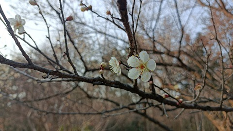
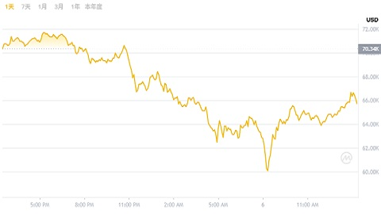
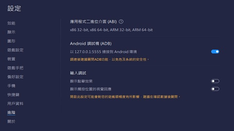
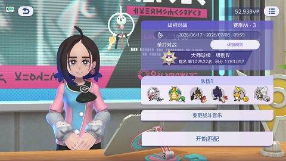

**01 月 01 日**

Happy New Year!

**01 月 09 日**

假设回到 10 年以前, 你发现有一个叫做李笑来的人, 他在推广比特币, 你会怎么做?

- 第一层: 防御嘲讽. 约 90% 的人停留在此. 本能的防御机制启动, 第一反应是质疑人的动机, 而非研究事物本身. 在信息到达大脑之前, 就已经被拒之门外.
- 第二层: 逻辑质疑. 约 9% 的人停留在此. "不就是一串数字吗", "没有国家信用背书", "是不是传销". 他们开始思考, 但依旧被困于旧的认知框架里, 用传统金融去理解新事物, 注定得出否定的结论.
- 第三层: 聚焦事物. 约 1% 的人停留在此. 他们忽略李笑来这个人, 而是开始阅读比特币的科普性文章. 从**质疑人转到研究事**, 是决定性的分水岭.
- 第四层: 深度研究. 约 0.1% 的人停留在此. 他们开始阅读白皮书, 研究底层技术, 思考其经济模型和社会影响.
- 第五层: 亲身试错. 约 0.05% 的人停留在此. 他们开始购买比特币, 使用比特币钱包, 亲身体验其运作机制. **在 10 年前, 进行这一步最多不过花十元钱以及一些时间成本**.
- 第六层: 最终赢家. 约 0.01% 的人到达此处. 长期持有.

<https://www.youtube.com/watch?v=ggzw_6EBHBY>

此视频之于我之感悟. 去年市场上其实有一些不错的机会, 不过我基本没有参与, 甚为可惜. 因为市场热点变化太快, NFT, 元宇宙, 铭文 ... 这些热点来的快去的也快, 所以去年那时候看到新的事物我本能就拒绝了: 莫不是又来割我的韭菜? 其实不然, 包括 polymarket 在内的很多项目, 都是有潜力的创新. 只是我没有耐心去研究. 今年我希望能改正这个缺点, 多尝试一些新的事物, 不要总是停留在质疑的阶段.

**01 月 21 日**

Safepal's USDT credit card looks great.

**01 月 22 日**

Tonight, I finished my last class at the Solana Bootcamp. It has been a great experience.

**01 月 24 日**

杭州植物园建立在山上, 比起园更像是一个小型的森林公园. 自然景观偏多, 人工造景较少, 和我想象中的植物园有些不同. 以前去过合肥的植物园, 那里更像是一个大型的花园, 展出各种各样的植物, 但杭州植物园根本就是围了一片山头...

目前正是白梅初开的季节, 大多数还是花苞, 只有少数开放.



**01 月 28 日**

今天去车管所换车牌, 选到一个浙 A 好牌!

**02 月 05 日**

What a terrible day, the cryptocurrency market is crashing! Bitcoin dropped to $71,000, which I didn't expect.

**02 月 06 日**

What happened today? Bitcoin dropped to $60,000. I thought the market would stabilize after yesterday's crash, but it seems like it's still going down.



**02 月 21 日**

I had a great lunar new year with my family.

My mother's illness seems to be getting better, which is a relief.

**03 月 22 日**

自上一次去上海已经是五年前了. 这次去参加 solana 的活动. 上海的交通系统非常拥挤, 车道狭小, 多数时候我们都在地下路网里穿行, 像是穴居的小生物.

**03 月 28 日**

I went to the lake to catch fish today, but unfortunately most of the fish were still hibernating.

**04 月 14 日**

你喜欢讨论一些已经有定论的东西, 而不是去学习并接受它的定论, 不仅浪费时间, 还显得很无知.

**06 月 07 日**

前往临安太湖源的 S218 省道居然在改建, 把我以前常去的一个摸鱼抓虾圣地给拆没了, 真是太可惜了.

**06 月 28 日**

这个月宝可梦冠军发布了手机版, 我手机安卓版本太低, 无法安装. 于是只能在电脑上安装了 bluestacks 安卓模拟器, 但又遇到了网络问题, 因为无法访问谷歌服务, 无法下载和登录游戏. 试了很多方法, 最后找到一个最简单的方案, 通过 adb 命令设置代理服务器, 让bluestacks 可以访问谷歌服务.

一. 在设置界面打开 adb 调式:



二. 在电脑上[下载 adb 工具](https://developer.android.com/tools/releases/platform-tools), 进入 adb 所在目录, 执行以下命令, 这个时候模拟器内部网络会走主机上部署在 1080 端口的的代理服务器. 其中 10.0.2.2 是个特殊的 ip 地址, 代表宿主机.

```ps1
$ .\adb.exe connect 127.0.0.1:5555

$ .\adb.exe -s 127.0.0.1:5555 shell settings put global http_proxy  10.0.2.2:1080
$ .\adb.exe -s 127.0.0.1:5555 shell settings put global https_proxy 10.0.2.2:1080
```


玩了几天, 上了大师球级别!



**07 月 16 日**


**10 月 30 日**

发生重大安全事件! 币安被盗约 63 亿美元, 成为加密货币历史上规模最大的网络盗窃案之一.

**11 月 17 日**

今天学到一个小知识, 叫做战或逃反应(Fight-or-Flight Response), 是人类和动物在面对潜在危险或巨大压力时, 由身体本能触发的一种紧急生存机制.

当生物接收到威胁信号时, 大脑会通过一条极快的神经高速公路迅速做出反应:

1. 察觉威胁: 感官信号首先传到大脑的丘脑, 随后分化: 一部分到达杏仁核(快速情绪处理中心, 直接拉响警报); 另一部分到达大脑皮层(进行逻辑分析和确认).
2. 下令调动: 如果确认有危险, 下丘脑会被激活, 向交感神经系统和内分泌系统发送指令.
3. 激素释放: 肾上腺迅速分泌肾上腺素和去甲肾上腺素, 让身体瞬间进入高度戒备状态.

接下来是选择: 战斗还是逃跑. 大脑会根据威胁的性质和自身的能力, 迅速做出决策. 如果认为自己有能力应对威胁, 就会选择战斗; 如果认为无法应对, 就会选择逃跑. 这一选择过程几乎是瞬间完成的, 完全依赖于本能和经验的快速判断.

在现代心理学研究中, 面对压力和威胁时, 生物的反应不仅限于战斗或逃跑, 还演化出了更丰富的生存策略:

- Fight(战): 迎难而上, 通过攻击或对抗来消除威胁.
- Flight(逃): 迅速撤离, 躲避危险.
- Freeze(僵住/装死): 吓得呆住, 无法动弹(当发现战和逃都无济于事时, 降低存在感以避开捕猎者视线).
- Fawn(讨好/顺从): 通过巴结, 顺从, 迎合对方来化解冲突(常见于人际关系或创伤应对中).

在远古时期, 这套机制用来帮祖先对抗猛兽; 而在现代社会, 猛兽变成了工作 deadline, 当众发言, 冲突争吵, 经济压力等心理或社会性威胁.

**11 月 18 日**

摩根大通发了一份名字叫《中国房地产: 只有幸存者才能生存》的研报. 用 ai 总结了一下:

报告将当前市场定性为一场"生存者游戏". 摩根大通在与约 50 位外资投资者的路演交流中发现, 多数投资者要求 50%–100% 的潜在回报才愿意配置中国地产资产. 这并非看好, 而是深度折价的体现: 意味着市场默认这类资产"会出问题", 只有价格足够低才足以补偿风险.

在此逻辑下, 投资标的的范围被急剧压缩. 外资反复讨论的名字集中在华润置地, 中国海外发展, 贝壳等少数财务稳健的央企龙头或现金流稳定的平台; 而已经出险的民营开发商(如碧桂园, 融创距历史高点跌去约 99%, 世茂几乎归零)几乎不再进入讨论视野. 报告直言, 在幸存者视角下, 中国地产在投资者眼中已"缩水为少数几家央企的代名词".

这份报告给出的不是一份关于"中国房地产何时反弹"的预测, 而是一张筛选名单: 在总量收缩与极致分化并存的阶段, 讨论行业本身的意义正在下降, 真正有分析价值的只剩下那些能够在流动性和资产负债表上活下来的少数主体.

**11 月 19 日**

自信:

一只鸟敢站在脆弱的枝条上歇脚, 它依仗的不是枝条不会断, 而是自己有翅膀, 会飞.
